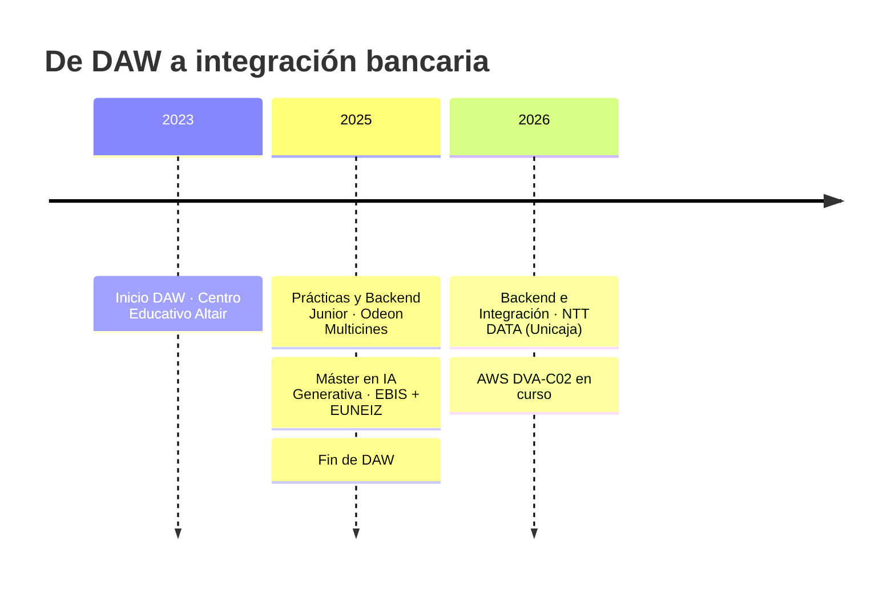
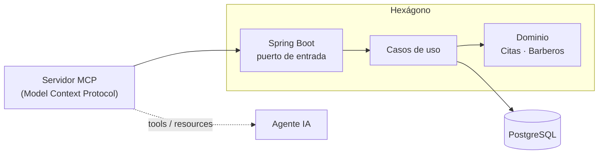

<p align="center">
  
</p>

<p align="center">
  <a href="https://www.eduballesteros.es"></a>
  <a href="https://www.linkedin.com/in/eduballesteross/"></a>
  <a href="https://www.eduballesteros.es/cv-eduardo-ballesteros.pdf"></a>
</p>

```json
{
  "nombre": "Eduardo Ballesteros Pérez",
  "rol": "Desarrollador Backend Java",
  "ubicacion": "Sevilla, España",
  "ahora": "APIs e integración bancaria en NTT DATA (cliente: Unicaja)",
  "construyendo": ["BarberMind · agente de IA + arquitectura hexagonal", "AWS DVA-C02 · Cloud Native"],
  "principios": ["SOLID", "Clean Architecture", "Hexagonal", "Clean Code"],
}
```

---

## ⚡ Sobre mí

Backend developer centrado en **Java y Spring Boot**. Resuelvo problemas complejos con **arquitectura hexagonal y patrones de integración**, en un entorno bancario donde la resiliencia no es opcional. Lo combino con **IA generativa** (máster EBIS + EUNEIZ) y **cloud**, rumbo a **AWS Certified Developer – Associate**.

## 🛤️ Trayectoria



<details>
<summary><b>💼 Detalle de experiencia</b></summary>

<br/>

| Periodo | Puesto | Empresa |
|---|---|---|
| Abr 2026 – Actualidad | Desarrollador Backend e Integración de Sistemas | **NTT DATA** (cliente: Unicaja) |
| Jul 2025 – Sep 2025 | Desarrollador Backend Junior | Odeon Multicines |
| Abr 2025 – Jul 2025 | Desarrollador Web (prácticas) | Odeon Multicines |

**Hoy:** diseño y gobierno de APIs REST con **IBM API Connect** y **App Connect Enterprise (ACE)**, microservicios con **Spring Boot**, pruebas de contrato y validación de endpoints con Postman.

</details>

---

## 🧰 Stack

| Capa | Tecnologías |
|---|---|
| ☕ **Backend** |      |
| 🧠 **IA** |   Prompt Engineering |
| 🗄️ **Datos y mensajería** |      |
| 🚀 **DevOps y cloud** |    |
| 🎨 **Frontend** |    |

---

## 🔥 Proyectos

### 💈 [Barber Mind](https://github.com/eduballesteros/barbermind) · *en desarrollo*

Gestión de citas B2B potenciada por IA y mensajería asíncrona. El reto: alta concurrencia sin *double-booking* gracias a bloqueos distribuidos en Redis, y un agente con LangChain que realiza transacciones en base de datos en tiempo real.



`Java` `Spring Boot` `PostgreSQL` `Redis` `RabbitMQ` `Docker` `Angular`

### 🌿 [Terra Nostra](https://github.com/eduballesteros/terra-nostra)

E-commerce full stack con microservicios y arquitectura limpia en capas. Seguridad con **Spring Security (OAuth2 + JWT)**, pagos reales con **PayPal SDK**, facturas PDF automatizadas y todo orquestado con Docker Compose.

`Java 21` `Spring Boot 3` `MySQL` `Docker` `Spring Security`

<p align="center">
  <a href="https://github.com/eduballesteros/barbermind"></a>
  <a href="https://github.com/eduballesteros/terra-nostra"></a>
</p>

---

## 🎓 Formación

- 🟠 **AWS Certified Developer – Associate (DVA-C02)** · en curso (2026) · S3, EC2, Lambda, IAM
- 🤖 **Máster en Ingeniería y Desarrollo de Soluciones con IA Generativa** · EBIS + EUNEIZ (2025 – 2026)
- 🎒 **Técnico Superior en Desarrollo de Aplicaciones Web** · Centro Educativo Altair (2023 – 2025)

## 📈 Actividad

<p align="center">
  
  
</p>

## 📫 Contacto

¿Un proyecto, una colaboración o charlar de tecnología? Escríbeme desde [eduballesteros.es](https://www.eduballesteros.es/#contacto) o por [LinkedIn](https://www.linkedin.com/in/eduballesteross/). Respondo en menos de 48 h.


